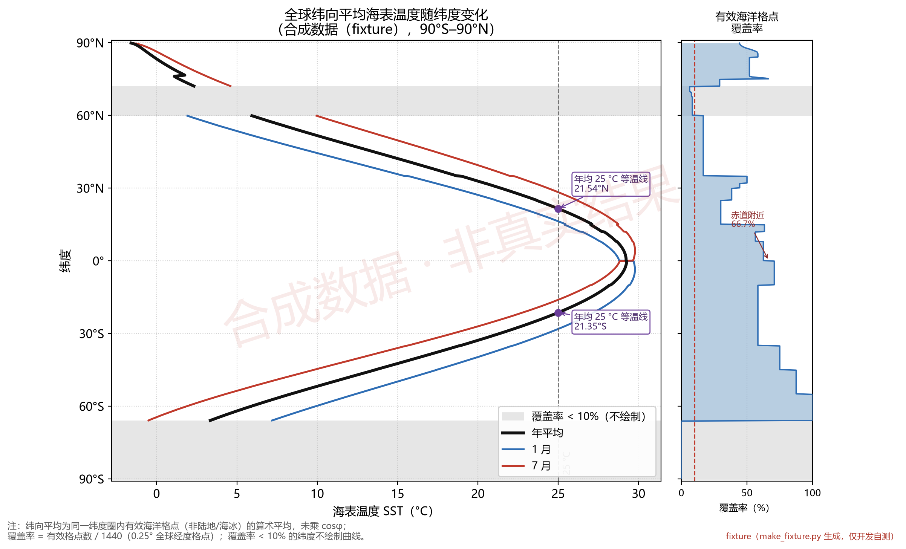

# 全球海表温度随纬度变化（2016–2020 气候态）—— 全球 + 五大洋

用 NOAA OISST v2.1 的 **0.25° 日平均海表温度**，对全球 **90°S–90°N、0–360°E** 的 60 个月度时次做纬向平均，
得到 720 个纬度圈的年均 / 1 月 / 7 月 SST 廓线、五大洋分盆对比、全球 0.25° 年均 SST 地图与
「月份 × 纬度」热图；并提供一套**不依赖 `compute.py`** 的独立复核脚本。旧的印度洋（20°E–120°E、
40°S–30°N）结果原样保留在[附录](#附录印度洋旧结果20162020)中，作为回归基准。

> **当前状态**：分析/绘图/复核代码已完成；真实全球数据由数据侧在并行分支产出，**全球关键结果数字与正式图件
> 待真实数据到位后再填入**（本文不填任何未经验证的全球数值）。下面展示的图均来自 `figures/dev/` 的
> **合成 fixture**，只用于开发自测，**不是观测结果**。



*图：合成 fixture 生成的全球纬向平均廓线示意（红字水印标明合成数据）。真实结果见 `figures/global_sst_vs_latitude.png`。*

## 1. 数据来源

- **数据集**：NOAA OISST v2.1（Daily Optimum Interpolation Sea Surface Temperature），日平均，0.25° 全球网格；
  变量 `sst(time, zlev, latitude, longitude)`，单位 °C，陆地与海冰为 `NaN`，经度采用 0–360。
- **获取入口**：NOAA CoastWatch ERDDAP griddap
  <https://coastwatch.pfeg.noaa.gov/erddap/griddap/ncdcOisst21Agg.csv>
- **每个时次的请求**（原生 0.25°，不加 stride，全球范围）：
  ```
  ?sst[(YYYY-MM-16T12:00:00Z):1:(YYYY-MM-16T12:00:00Z)][(0.0):1:(0.0)][(-90.0):1:(90.0)][(0.0):1:(359.75)]
  ```
- **时次**：2016–2020 年，每月 16 日 12:00 UTC 一个时次，共 **60 个**。
- **返回规模**：2 行表头 + 720 × 1440 = 1,036,800 行数据。**实测体积**：单时次 CSV **45.8 MB**；
  60 个时次解压后合计 **2.75 GB**；gzip 无损压缩后传输量约 **270 MB**，落盘约 **250 MB**
  （不同时次压缩率略有差异）。
- **引用**：Huang, B., et al. (2021). Improvements of the Daily Optimum Interpolation Sea Surface Temperature
  (DOISST) Version 2.1. *Journal of Climate*, 34(8), 2923–2939.

## 2. 目录结构

```
.
├── requirements.txt              # numpy / pandas / matplotlib（无新增依赖）
├── README.md
├── data/
│   ├── raw/                      # 60 个 sst_YYYY_MM.csv.gz + manifest.json（不入库，可一键重下）
│   ├── zonal_mean_global.csv     # 720 行全球纬向平均（数据侧产出，入库）
│   ├── zonal_mean_basins.csv     # global + 五大洋纵向堆叠（数据侧产出，入库）
│   ├── climatology_grid.npz      # 720×1440 月气候态网格（数据侧产出，入库）
│   ├── basin_mask.npz            # 可选：海盆编号网格 / 边界
│   ├── summary_metrics.json      # 可选：各海盆 cosφ 加权均温等汇总
│   ├── zonal_mean.csv            # 旧印度洋结果（281 行，回归基准，入库）
│   └── verify_report.json        # verify.py 生成的复核报告（不入库）
├── figures/
│   ├── global_sst_vs_latitude.png
│   ├── basins_sst_vs_latitude.png
│   ├── global_sst_map.png
│   ├── lat_month_heatmap.png
│   ├── indian_vs_global.png
│   ├── dev/                      # fixture 自测图（合成数据，带水印，可入库）
│   └── sst_vs_latitude.png       # 旧印度洋两张图（保留）
├── scripts/
│   ├── config.py                 # 数据侧维护：路径、全球范围、时间、阈值
│   ├── fetch_data.py             # 数据侧维护：按月下载 / 校验 / gzip 缓存
│   ├── compute.py                # 数据侧维护：raw → zonal_mean_global/basins + npz
│   ├── run_all.py                # 数据侧维护：一键下载 → 计算 → 绘图 → 验收
│   ├── plot.py                   # 本分支：全球版绘图（真实数据缺失时自动用 fixture）
│   ├── verify.py                 # 本分支：独立复核（不 import compute.py）
│   └── make_fixture.py           # 本分支：生成合成 fixture（只写 .tmp/）
└── tests/
    └── test_verify.py            # 复核逻辑单元测试（unittest，无新增依赖）
```

> 协作边界：`config.py` / `fetch_data.py` / `compute.py` / `run_all.py` 与 `data/` 下的真实数据由**数据侧**维护；
> 本分支只改 `plot.py`、新增 `verify.py` / `make_fixture.py` / `tests/`，以及 README 中与数字无关的方法/结构。

## 3. 数据契约

分析/绘图侧按下列文件名与列名读取，并对大小写、额外列做容错；缺失可选文件时自动降级。

| 文件 | 内容 |
| --- | --- |
| `data/zonal_mean_global.csv` | 720 行（-89.875…89.875，0.25°），18 列：`latitude, valid_count, coverage, sst_annual, sst_jan, sst_jul, sst_01…sst_12`；`coverage = valid_count / 1440` |
| `data/zonal_mean_basins.csv` | 首列 `basin`（`global/indian/pacific/atlantic/arctic/southern`，容忍大小写），后接同样 18 列；多海盆**纵向堆叠**在同一文件；可选 `ocean_grid_count` 与 `coverage_01…coverage_12` |
| `data/climatology_grid.npz` | 键 `lat`(720)、`lon`(1440)、`sst_annual`(720×1440)、`sst_01…sst_12`（同形）；`NaN` = 陆地/海冰 |
| `data/basin_mask.npz` | 可选：`basin_id`(720×1440) 或边界折线；不存在时地图不画海盆边界并在图注说明 |
| `data/summary_metrics.json` | 可选：各海盆 cosφ 加权均温等；字段名不固定，读不到就由 CSV 现算 |

`data/verify_report.json` 由 `verify.py` 生成（结构见第 7 节），是可复现的复核产物，默认不入库。

## 4. 方法与统计口径

1. **网格**：全球 0.25° 原生格点 **720 行 × 1440 列**（lat -89.875…89.875，lon 0.125…359.875），
   不降采样、不重采样、不平滑。
2. **纬向平均**：同一纬度圈内，对所有有效（非 `NaN`）海洋格点取**算术平均**；
   **不乘 cosφ**（同一纬度圈上各格点面积相同）。cosφ 仅用于跨纬度求海盆/全球平均。
3. **有效格点数与覆盖率**：`valid_count` 是该纬度 60 个时次有效格点数的平均值（0–1440）；
   全球文件 `coverage = valid_count / 1440`。分海盆文件若提供 `ocean_grid_count`，
   则分盆 `coverage = valid_count / ocean_grid_count`（分母是该纬度该海盆的海洋格点数）。
4. **时间维度**：逐时次求纬向平均 → 同一月份 5 个年份取平均，得到 12 个月气候态 →
   12 个月**等权**平均得到年均。
5. **绘图阈值**：只绘制 `coverage ≥ 10%` 的纬度段。阈值写成可配置常量 `DEFAULT_COVERAGE_MIN`
   （`scripts/plot.py`），可用 `--coverage-min` 或环境变量 `SST_COVERAGE_MIN` 覆盖。
6. **季节反相**：北半球 1 月冷、7 月暖，南半球相反；`verify.py` 用 20°–60° 纬度带的 cosφ 加权均值
   检查这一符号关系。
7. **体积处理**：60 个时次未压缩约 2.75 GB，因此原始响应以 **gzip 无损压缩**保存为
   `data/raw/sst_YYYY_MM.csv.gz`（落盘约 250 MB），解压后与 ERDDAP 返回逐字节一致；
   计算时直接读取 gz，数据本身未裁剪或降采样。

## 5. 复现步骤

环境：**Python 3.14**（本机 `.venv`，实测 3.14.0，Windows 11），仅需 `numpy / pandas / matplotlib`，
**不新增任何依赖**。

```powershell
# 数据侧：下载 → 计算 → 绘图 → 验收（需要联网，约 2.75 GB 解压数据）
.venv\Scripts\python.exe scripts\fetch_data.py
.venv\Scripts\python.exe scripts\compute.py
.venv\Scripts\python.exe scripts\plot.py

# 分析侧独立复核（不 import compute.py）
.venv\Scripts\python.exe scripts\verify.py
.venv\Scripts\python.exe scripts\verify.py --skip-online   # 不联网
```

- **绘图自动降级**：`plot.py` 启动时检查 `zonal_mean_global.csv` / `zonal_mean_basins.csv` /
  `climatology_grid.npz`。三者任一缺失就打印「真实数据未就绪，使用 fixture」，自动在 `.tmp/fixture/`
  生成合成数据并出图到 `figures/dev/`，**进程 0 退出**；三者齐全时出正式图到 `figures/`。
  `--fixture` 可强制走合成数据，`--refresh-fixture` 重新生成，`--figures profile,map` 只画指定图。
- 字体：自动选用 **Microsoft YaHei**（缺失时退回 SimHei）；保存时逐个字符检查字形，
  有豆腐块会直接报错；保存后校验 PNG 文件头与像素尺寸。
- **印度洋回归**：`plot.py` 每次运行都会用仓库已提交的 `data/zonal_mean.csv`（281 行）复算
  README 旧值（最高 29.14 °C @ 2.12°N、25 °C 等温线 21.66°S、海盆均值 26.16 °C），不一致则非零退出。
- 自测：
  ```powershell
  .venv\Scripts\python.exe scripts\make_fixture.py
  .venv\Scripts\python.exe scripts\plot.py --fixture
  .venv\Scripts\python.exe scripts\verify.py --data-dir .tmp\fixture --skip-online
  .venv\Scripts\python.exe -m unittest discover -s tests -v
  ```

## 6. 图件说明

| 图 | 内容 |
| --- | --- |
| `global_sst_vs_latitude.png` | 90°S–90°N 年均 / 1 月 / 7 月曲线 + 右侧覆盖率面板；年均 **25 °C 等温线的南北半球交点同时标注**（旧版 `find_isotherm(...)[-1]` 只取最后一个，会漏掉北半球）；覆盖率 < 10% 的纬度灰底不画 |
| `basins_sst_vs_latitude.png` | 五大洋分盆年均曲线 + 旧印度洋结果（灰色点划线）对照；右面板为 1 月（实线）/ 7 月（虚线），展示南北半球季节反相 |
| `global_sst_map.png` | 0.25° 全球年均 SST 等经纬（Plate Carrée）地图，色标固定 −2～32 °C，叠加 25 °C 等值线；有 `basin_mask.npz` 时叠加近似海盆边界。**未引入 cartopy**，图注中说明投影 |
| `lat_month_heatmap.png` | 全球 12 个月 × 纬度热图，黑色等值线 25 °C，灰色为覆盖率不足的纬度 |
| `indian_vs_global.png` | 印度洋旧廓线 vs 全球廓线，副图为「印度洋 − 全球」差值（仅重叠纬度、有效值处） |

当前 `figures/dev/` 中 fixture 自测图的实测尺寸/体积（单图均 < 2 MB）：

| 文件 | 像素 | 体积 |
| --- | --- | --- |
| `global_sst_vs_latitude.png` | 2404 × 1457 | 353 KB |
| `basins_sst_vs_latitude.png` | 2876 × 1421 | 446 KB |
| `global_sst_map.png` | 2376 × 1187 | 324 KB |
| `lat_month_heatmap.png` | 2482 × 1318 | 210 KB |
| `indian_vs_global.png` | 2364 × 1630 | 245 KB |

> 以上尺寸来自合成 fixture；真实数据到位后正式图可能因数值范围略有变化。图中红字水印表明合成数据身份。

## 7. 独立复核（`scripts/verify.py`）

`verify.py` **不 import `compute.py` 的任何函数**，从零实现口径，逐项给出 `pass/fail/skip`：

1. **数值复算**：读取 `data/raw/` 的 60 个 `csv.gz`，独立重算「逐时次纬向平均 → 同月多年平均 →
   12 月等权年均」，抽 **8 个纬度（-70/-45/-20/0/20/40/60/75°）× 1 月、7 月** 与
   `zonal_mean_basins.csv` 的 `global` 行对齐，容差 **0.01 °C**；年均同纬度一并比对。
2. **结构性检查**：720 行、0.25° 步长、纬度单调、`coverage ∈ [0,1]`、`valid_count` 与 `coverage`
   自洽、海洋值不超出 −2～35 °C、1 月/7 月南北半球季节反相、分海盆行数与 global 行一致性。
3. **网格一致性**：`climatology_grid.npz` 键/形状齐全；只在「60 个时次全为海洋」的纬度比较
   网格纬向平均与 CSV，避免冰缘处「先平均后平均」的固有差异被误判。
4. **在线抽样**：直接向 ERDDAP 取 2–3 个时次 × 约 1° 窄带（很小的请求），与本地同一时次 raw
   逐纬圈比对，容差 **0.05 °C**；网络不通时输出「跳过在线复核」，**不算失败**。
5. **印度洋回归**：用 `data/zonal_mean.csv` 复算旧 README 的三个关键数字。
6. 结果写入 `data/verify_report.json`（fixture 模式写到对应目录），打印汇总；
   **实际比对失败才非零退出**，数据未就绪/网络不通只记 `skip`。

当前工作区（真实全球数据未就绪）实测：

```text
[SKIP] zonal_mean_global.csv 结构          # 真实数据未就绪
[SKIP] zonal_mean_basins.csv 结构          # 真实数据未就绪
[SKIP] climatology_grid.npz 一致性         # 真实数据未就绪
[SKIP] data/raw 独立数值复算               # 无 60 个 raw 文件
[SKIP] ERDDAP 在线抽样复核                 # 无同时次 raw 可比对
[PASS] 印度洋旧结果回归                     # 29.14 °C @ 2.12°N；21.66°S；26.16 °C
结论：pass_with_skips（通过 1 / 失败 0 / 跳过 5），退出码 0
```

fixture 自测：`verify.py --data-dir .tmp/fixture --skip-online` →
`pass_with_skips（通过 4 / 失败 0 / 跳过 2）`，退出码 0。
单元测试 7 项（等温线双交点、印度洋回归、raw 重算往返、60 时次全流程、覆盖率自洽/破坏检测）全部通过。

## 8. 关键结果（待真实数据填入）

> 数据侧产出 `zonal_mean_global.csv` / `zonal_mean_basins.csv` / `climatology_grid.npz` 后，
> 运行 `plot.py` 与 `verify.py` 填入下列数字；**在此之前不填任何推测值**。

- 全球年均 SST 最高值及所在纬度：待填
- 年均 25 °C 等温线（北半球 / 南半球）：待填
- 五大洋 cosφ 加权年均 SST：待填
- 覆盖率最低的纬度及数值（10% 阈值附近）：待填
- 1 月 / 7 月季节振幅随纬度变化：待填

## 9. 已知局限

- **10% 覆盖率阈值与极地海冰**：北冰洋冬季、南大洋高纬在 60 个时次平均后有效格点可能低于 10%，
  这些纬度不绘制；阈值附近结果对阈值敏感。
- **海盆边界是近似划分**：印度洋 20°E–120°E、太平洋 120°E–280°E、其余归大西洋，66°N 以北为北冰洋、
  60°S 以南为南大洋；与正式海盆定义存在差异，分盆均温只用于量级对比。
- **每月只取 16 日一个时次**：不能代表整月平均，也不反映 MJO、季节内振荡；5 年气候态仍受 ENSO/IOD 影响。
- **0.25°（约 28 km）分辨率**无法解析近岸、海峡和海湾；OISST 近岸为插值/掩膜结果，存在不确定性。
- **纬向平均抹平经向差异**：不能替代阿拉伯海、孟加拉湾、副热带环流等区域分析。
- **权重**：纬向平均不乘 cosφ；只有跨纬度求海盆/全球平均时才用 cosφ 面积权重，两者不可混用。
- **年均是 12 个月等权平均**（不按每月天数加权）。
- **未做趋势分析或显著性检验**，结论仅描述 2016–2020 年气候态。
- **fixture 不是观测**：`make_fixture.py` 用解析公式合成赤道暖、两极冷、季节反相、陆地 NaN、
  海冰进退的数据，只用于开发自测；`figures/dev/` 的图一律带「合成数据」水印，禁止当作真实结果引用。

## 10. 数据与图件是否入库

- **`data/raw/` 不入库**：60 个 gzip CSV 约 250 MB，`fetch_data.py` 可一键重新下载；
  `manifest.json` 记录每个文件的原始/压缩字节数与请求信息。
- **`data/zonal_mean_global.csv` / `zonal_mean_basins.csv` / `climatology_grid.npz` 入库**（数据侧产出），
  是全部全球结论的数值基础。
- **`data/zonal_mean.csv` 入库**：旧印度洋 281 行结果，作为回归基准保留。
- **`figures/` 五张全球 PNG 入库**；`figures/dev/` 的 fixture 图可入库但单图 < 2 MB，且必须保留合成水印。
- **`data/verify_report.json` 不入库**（`.gitignore` 已忽略），由 `verify.py` 随时重新生成。
- 原始 CSV 未压缩约 2.75 GB，故以 gzip 无损压缩保存；读取时解压，内容不变。

---

## 附录：印度洋旧结果（2016–2020）

以下为项目早期「印度洋 20°E–120°E、40°S–30°N」版本的原结果，**数值与图件均未改动**，
用作全球版口径的回归基准（`plot.py` / `verify.py` 每次都会复算校验）。


旧口径：0.25° 原生格点 **401 列 × 281 行**（20.125–120.125°E、-39.875–30.125°N），
`coverage = valid_count / 401`，12 个月等权年均，覆盖率 < 10% 不绘制。

旧关键结果（与 `data/zonal_mean.csv` 和 `scripts/compute.py` 输出一致）：

1. **年均 SST 最高 29.14 °C，出现在 2.12°N**；10°S–10°N 一带年均普遍在 28 °C 以上（印度洋暖池）。
2. **年均 25 °C 等温线位于 21.66°S**；向南快速降温，30°S 年均 21.22 °C，40°S 14.89 °C。
3. **20–26°N 覆盖率最低 9.5%，出现在 25.88°N**——该纬度 401 个格点中平均仅约 38 个是有效海洋格点，
   所以 26°N 以北的纬向平均不可信、不绘制曲线。
4. **季节振幅随纬度增大**：25.38°N 处 1 月 22.72 °C、7 月 31.15 °C（相差约 8.4 °C）；
   赤道附近 1 月 28.68 °C、7 月 28.77 °C（仅差 0.08 °C）；南半球相反，20°S 1 月 27.06 °C、7 月 24.12 °C。
5. **全海盆年均 SST（cosφ 加权，仅覆盖率 ≥ 10% 的纬度）为 26.16 °C**。

旧覆盖率：赤道约 65.1%（印尼群岛陆地多）、10°S 约 80.0%、40°S 为 100%。
旧版本环境为 Python 3.12、`data/zonal_mean.csv` 281 行、两张 PNG 分别约 289 KB / 126 KB。
