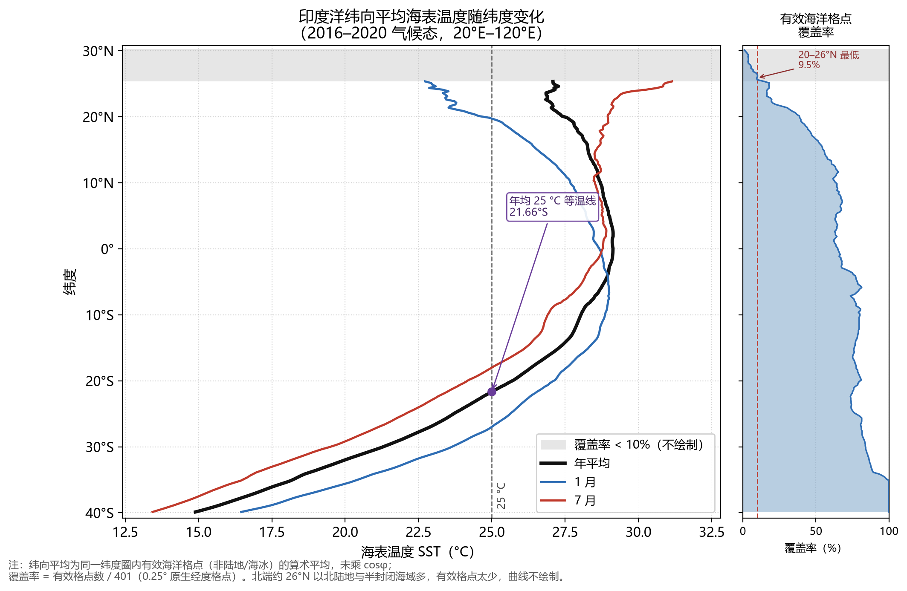

# 印度洋海面温度随纬度变化（2016–2020 气候态）

用 NOAA OISST v2.1 的 0.25° 日平均海表温度，对印度洋 **20°E–120°E、40°S–30°N** 的 60 个月度时次做纬向平均，
得到 281 个纬度圈的年均 / 1 月 / 7 月 SST 廓线与「月份 × 纬度」热图。一条命令即可从零复现。




## 1. 数据来源

- **数据集**：NOAA OISST v2.1（Daily Optimum Interpolation Sea Surface Temperature），日平均，0.25° 网格；
  变量 `sst(time, zlev, latitude, longitude)`，单位 °C，陆地与海冰为 `NaN`，经度采用 0–360。
- **获取入口**：NOAA CoastWatch ERDDAP griddap
  <https://coastwatch.pfeg.noaa.gov/erddap/griddap/ncdcOisst21Agg.csv>
- **每个时次的请求**（原生 0.25°，不加 stride）：
  ```
  ?sst[(YYYY-MM-16T12:00:00Z):1:(YYYY-MM-16T12:00:00Z)][(0.0):1:(0.0)][(-40.0):1:(30.0)][(20.0):1:(120.0)]
  ```
- **时次**：2016–2020 年，每月 16 日 12:00 UTC 一个时次，共 **60 个**。
- **返回规模**：2 行表头（变量名 / 单位）+ 281 × 401 = 112,681 行数据；原始 CSV 5.04 MB/时次，
  60 个时次合计 **302.4 MB**（未压缩）。
- **引用**：Huang, B., et al. (2021). Improvements of the Daily Optimum Interpolation Sea Surface Temperature
  (DOISST) Version 2.1. *Journal of Climate*, 34(8), 2923–2939.

## 2. 目录结构

```
.
├── requirements.txt
├── README.md
├── data/
│   ├── raw/                    # 60 个 sst_YYYY_MM.csv.gz + manifest.json（不入库，可一键重下）
│   └── zonal_mean.csv          # 281 行纬向平均结果（入库）
├── figures/
│   ├── sst_vs_latitude.png     # 年均 / 1 月 / 7 月曲线 + 覆盖率面板
│   └── lat_month_heatmap.png   # 12 个月 × 纬度热图
└── scripts/
    ├── config.py               # 研究区、时间、路径等常量
    ├── fetch_data.py           # 按月下载、校验、缓存（支持 --force）
    ├── compute.py              # 读 raw → data/zonal_mean.csv，并打印关键数字
    ├── plot.py                 # 绘制两张图（中文标签 + 字形检查）
    └── run_all.py              # 一键跑完 下载 → 计算 → 绘图 → 验收
```

## 3. 方法与统计口径

1. **研究区与网格**：20°E–120°E、40°S–30°N；只使用 **0.25° 原生格点**（401 列 × 281 行），
   不做降采样、重采样或平滑。纬度格点中心为 -39.875…30.125（覆盖 -40…30），经度为 20.125…120.125°E。
2. **纬向平均**：同一纬度圈内，对所有有效（非 `NaN`）海洋格点取 **算术平均**；
   **不乘 cosφ**（同一纬度圈上各格点面积相同）。cosφ 只用于跨纬度求全海盆平均。
3. **有效格点数与覆盖率**：`valid_count` 是该纬度 60 个时次有效格点数的平均值（0–401）；
   `coverage = valid_count / 401`。
4. **时间维度**：逐时次求纬向平均 → 对同一月份 5 个年份取平均，得到 12 个月气候态 →
   12 个月 **等权** 平均得到年均。
5. **绘图阈值**：只绘制 `coverage ≥ 10%` 的纬度段。60 个时次平均后，北端从 25.375°N（14.5%）往上迅速下降，
   25.875°N 只有 9.5%，因此曲线止于约 25.4°N（与「北端大约止于 26°N」一致）。
6. **体积处理**：60 个时次未压缩共 302.4 MB，略超 300 MB 上限，因此原始响应以 **gzip 无损压缩**
   存为 `data/raw/sst_YYYY_MM.csv.gz`（合计 27.0 MB），解压后与 ERDDAP 返回逐字节一致；
   计算时直接读取 gz，数据本身未做任何裁剪或降采样。

`data/zonal_mean.csv` 的列：

| 列 | 含义 |
| --- | --- |
| `latitude` | 纬度（°N，-39.875…30.125，步长 0.25） |
| `valid_count` | 60 个时次平均的有效海洋格点数（0–401） |
| `coverage` | `valid_count / 401` |
| `sst_annual` | 年平均 SST（°C） |
| `sst_jan` / `sst_jul` | 1 月 / 7 月气候态 SST（°C） |
| `sst_01` … `sst_12` | 12 个月气候态（供热图使用，附加列） |

## 4. 复现步骤

环境：**Python 3.12**（实测 3.12.10，Windows 11）。

```powershell
py -3.12 -m venv .venv
.venv\Scripts\activate
pip install -r requirements.txt -i https://pypi.tuna.tsinghua.edu.cn/simple
python scripts/run_all.py
```

- 从**空 `data/`** 开始：下载约 2–5 分钟（4 并发，实测 122 s / 290 s 两次），计算约 3 s，绘图约 2 s，总计约 2–5 分钟。
- 已有缓存时自动跳过下载（实测 1.3 s 完成校验与清单重建）；`--force-download` 强制重下，`--jobs N` 调整并发。
- 也可分步执行：
  ```powershell
  python scripts/fetch_data.py     # 下载 / 断点续传；--force 强制重下
  python scripts/compute.py        # 生成 data/zonal_mean.csv 并打印关键数字
  python scripts/plot.py           # 生成两张 PNG
  ```
- 字体：自动选用 **Microsoft YaHei**（缺失时退回 SimHei）；保存时逐个字符检查字形，若有豆腐块会直接报错。
- `run_all.py` 结束时会自动验收：CSV 行数/纬度步长、PNG 是否存在且 > 100 KB、原始文件数与体积，并再次打印关键数字。

## 5. 关键结果

> 以下数字与 `python scripts/compute.py` / `run_all.py` 的输出完全一致。

1. **年均 SST 最高 29.14 °C，出现在 2.12°N**；10°S–10°N 一带年均普遍在 28 °C 以上（印度洋暖池）。
2. **年均 25 °C 等温线位于 21.66°S**；向南快速降温，30°S 年均 21.22 °C，40°S 14.89 °C。
3. **20–26°N 覆盖率最低 9.5%，出现在 25.88°N**——该纬度 401 个格点中平均仅约 38 个是有效海洋格点，
   所以 26°N 以北的纬向平均不可信、不绘制曲线。
4. **季节振幅随纬度增大**：25.38°N 处 1 月 22.72 °C、7 月 31.15 °C（相差约 8.4 °C）；
   赤道附近 1 月 28.68 °C、7 月 28.77 °C（仅差 0.08 °C）；南半球相反，20°S 1 月 27.06 °C、7 月 24.12 °C。
5. **全海盆年均 SST（cosφ 加权，仅覆盖率 ≥ 10% 的纬度）为 26.16 °C**。

附：年均覆盖率赤道约 65.1%（印尼群岛陆地多）、10°S 约 80.0%、40°S 为 100%。

## 6. 图表说明

- `figures/sst_vs_latitude.png`（2127 × 1387 px）：左图为年均、1 月、7 月三条 SST–纬度曲线，
  横轴 SST（°C）、纵轴纬度；虚线标出 25 °C 等温线（21.66°S）。灰色区域为覆盖率 < 10% 的北端（不绘制曲线）。
  右侧窄图为有效海洋格点覆盖率随纬度的变化，可作为主图的次要信息对照。
- `figures/lat_month_heatmap.png`（1867 × 1242 px）：12 个月 × 纬度的纬向平均 SST 热图，黑色等值线为 25 °C，
  灰色/空白为覆盖率 < 10%、不参与绘制的纬度。
- 两图标签均为中文，使用 Microsoft YaHei；渲染时检查了图中全部非 ASCII 字符（分别 73 和 29 个）的字形，
  并确认 matplotlib 没有 missing-glyph 警告，无豆腐块。

## 7. 已知局限

- 每月只取 16 日一个时次，不能代表整月平均，也不反映 MJO、季节内振荡等；5 年气候态仍受 ENSO/IOD 年际信号影响。
- 纬向平均抹平了阿拉伯海、孟加拉湾、南印度洋副热带环流等的经向差异，不能替代区域分析。
- 20–26°N 陆地与半封闭海域多（阿拉伯半岛、印度、孟加拉湾、波斯湾），10% 阈值附近的结果对阈值敏感；
  北端纬向平均受波斯湾夏季高温浅水影响，数值不可靠，因此不绘制。
- 0.25°（约 28 km）分辨率无法解析近岸、海峡和海湾；OISST 近岸为插值/掩膜结果，存在不确定性。
- 年均是 12 个月等权平均（不按每月天数加权）；全海盆平均才使用 cosφ 面积权重。
- 未做趋势分析或显著性检验，结论仅描述 2016–2020 年的气候态。

## 8. 数据与图件是否入库

- **`data/raw/` 不入库**：60 个 gzip CSV 共 27.0 MB，`fetch_data.py` 可一键重新下载；
  `manifest.json` 记录每个文件的原始/压缩字节数与请求信息。
- **`data/zonal_mean.csv` 入库**（281 行，34.7 KB），是全部结论的数值基础。
- **`figures/` 两张 PNG 入库**（289 KB、126 KB），便于直接查看结果。
- 原始 CSV 未压缩为 302.4 MB，略超 300 MB 上限，故以 gzip 无损压缩保存（27.0 MB）；读取时解压，内容不变。
