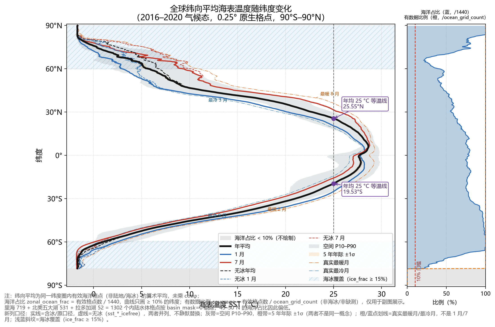
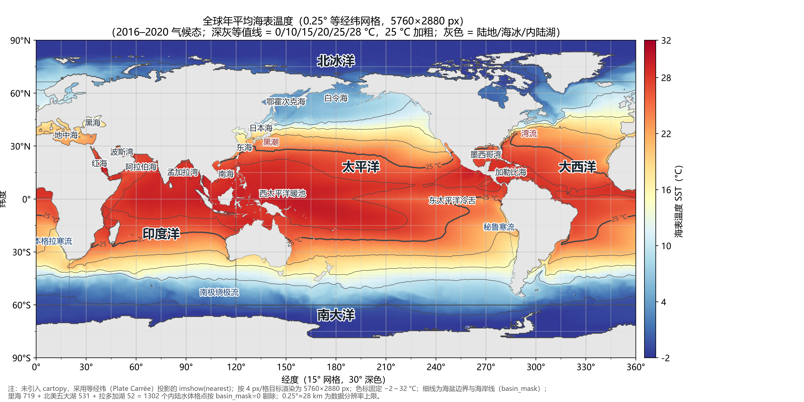
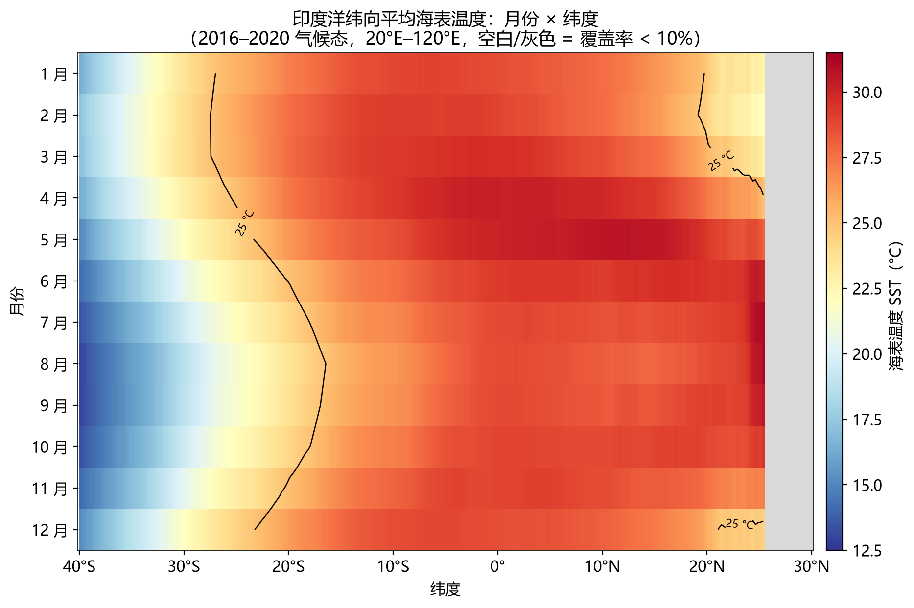

# 全球海表温度随纬度变化（2016–2020 气候态）—— 全球 + 五大洋

用 NOAA OISST v2.1 的 **0.25° 日平均海表温度**，对全球 **90°S–90°N、0–360°E** 的 60 个月度时次做纬向平均，
得到 720 个纬度圈的年均 / 1 月 / 7 月 SST 廓线、五大洋分盆对比、全球 0.25° 年均 SST 地图
（4K 等经纬 + 重点海域放大 + Mollweide 等面积 + 同纬度异常 + 可缩放交互 HTML）与「月份 × 纬度」热图；
并提供一套**不依赖 `compute.py`** 的独立复核脚本。旧的印度洋（20°E–120°E、40°S–30°N）结果原样保留在
[附录](#附录印度洋旧结果20162020)中，作为回归基准。

> **当前状态**：数据侧 Wave 1 已合入 master（`0f784b3`，720×55 / 2215×55 双口径 CSV、11 MB anomaly_grid、zonal_ref 等入库），
> 本分支已 rebase 到该提交；`figures/` 下 8 张正式静态图 + 1 个交互 HTML 与下方关键结果均由这批真实数据产出，
> `scripts/verify.py` 的完整复核（60 时次 raw 重算 + 无冰 raw + 异常场 + 统计列 + ERDDAP 在线抽样）9 项全部 PASS。



*图：2016–2020 全球纬向平均海表温度；黑=年均，蓝=1 月，红=7 月，右侧副图为海洋占比与 coverage。*



*图：0.25° 全球年均 SST 4K 地图；白色/灰色为陆地/内陆湖，黑线为 25 °C 等值线。更细查看请打开
[`figures/global_sst_map.html`](figures/global_sst_map.html) 交互地图。*

## 1. 数据来源

- **数据集**：NOAA OISST v2.1（Daily Optimum Interpolation Sea Surface Temperature），日平均，0.25° 全球网格；
  变量 `sst(time, zlev, latitude, longitude)`，单位 °C，陆地与海冰为 `NaN`，经度采用 0–360。
- **获取入口**：NOAA CoastWatch ERDDAP griddap
  <https://coastwatch.pfeg.noaa.gov/erddap/griddap/ncdcOisst21Agg.csv>
- **每个时次的请求**（原生 0.25°，不加 stride，全球范围）：
  ```
  ?sst[(YYYY-MM-16T12:00:00Z):1:(YYYY-MM-16T12:00:00Z)][(0.0):1:(0.0)][(-89.875):1:(89.875)][(0.125):1:(359.875)]
  ```
- **时次**：2016–2020 年，每月 16 日 12:00 UTC 一个时次，共 **60 个**。
- **返回规模**：2 行表头 + 720 × 1440 = 1,036,800 行数据。**实测体积**：单时次 CSV **45.8 MB**；
  60 个时次解压后合计 **2.75 GB**；gzip 无损压缩后传输量约 **270 MB**，落盘约 **250 MB**
  （不同时次压缩率略有差异）。
- **引用**：Huang, B., et al. (2021). Improvements of the Daily Optimum Interpolation Sea Surface Temperature
  (DOISST) Version 2.1. *Journal of Climate*, 34(8), 2923–2939.

## 2. 目录结构

```
.
├── requirements.txt              # numpy / pandas / matplotlib（无新增依赖）
├── README.md
├── data/
│   ├── raw_global/               # 60 个 sst_YYYY_MM.csv.gz（全球，约 252 MB，不入库）
│   ├── zonal_mean_global.csv     # 720 行全球纬向平均（数据侧产出，入库）
│   ├── zonal_mean_basins.csv     # global + 五大洋纵向堆叠（数据侧产出，入库）
│   ├── climatology_grid.npz      # 720×1440 网格产物（数据侧产出，入库）
│   ├── basin_mask.npz            # 海盆掩膜：basin_mask(uint8)/basin_id(int8)
│   ├── summary_metrics.json      # 数据侧汇总：basins.<name>.mean_sst_cos_weighted 等
│   ├── anomaly_grid.npz          # 可选：数据侧权威 sst_*_anom/icefree/anomaly 场
│   ├── zonal_ref.csv             # 可选：latitude, ref_annual/ref_jan/ref_jul
│   ├── zonal_mean.csv            # 旧印度洋结果（281 行，回归基准，入库）
│   └── verify_report.json        # verify.py 生成的复核报告（不入库）
├── figures/
│   ├── global_sst_vs_latitude.png
│   ├── basins_sst_vs_latitude.png
│   ├── global_sst_map.png
│   ├── global_sst_map_regions.png
│   ├── global_sst_map_mollweide.png
│   ├── global_sst_anomaly.png
│   ├── global_sst_map.html
│   ├── lat_month_heatmap.png
│   ├── indian_vs_global.png
│   ├── dev/                      # fixture 自测图（合成数据；已 gitignore，不入库）
│   ├── sst_vs_latitude.png       # 旧印度洋曲线（保留）
│   └── lat_month_heatmap_indian.png  # 旧印度洋热图（保留；全局同名图占用了 lat_month_heatmap.png）
├── scripts/
│   ├── config.py                 # 数据侧维护：路径、全球范围、时间、阈值
│   ├── fetch_data.py             # 数据侧维护：按月下载 / 校验 / gzip 缓存
│   ├── compute.py                # 数据侧维护：raw → zonal_mean_global/basins + npz
│   ├── run_all.py                # 本分支：全球版一键 下载→计算→绘图→独立复核→验收
│   ├── plot.py                   # 本分支：全球版绘图（真实数据缺失时自动用 fixture）
│   ├── make_map_viewer.py        # 本分支：生成自包含交互地图 HTML（int16 + canvas）
│   ├── map_labels.py             # 本分支：中文海区/洋流标注表（静态图与 HTML 共用）
│   ├── verify.py                 # 本分支：独立复核（不 import compute.py）
│   └── make_fixture.py           # 本分支：生成合成 fixture（只写 .tmp/）
└── tests/
    └── test_verify.py            # 复核逻辑单元测试（unittest，无新增依赖）
```

> 协作边界：`config.py` / `fetch_data.py` / `compute.py` 与 `data/` 下的真实数据由**数据侧**维护；
> `plot.py` / `verify.py` / `make_fixture.py` / `make_map_viewer.py` / `map_labels.py` / `run_all.py` / `tests/` 为本分支维护。

## 3. 数据契约

分析/绘图侧按下列文件名与列名读取，并对大小写、额外列做容错；缺失可选文件时自动降级。

| 文件 | 内容 |
| --- | --- |
| `data/zonal_mean_global.csv` | 720 行（-89.875…89.875，0.25°）；必需列 `latitude, valid_count, coverage, sst_annual, sst_jan, sst_jul`，另有 `ocean_grid_count`、`sst_01…sst_12`、`cov_01…cov_12`、`zonal_ocean_frac`（列顺序以数据侧为准，代码按列名读取）。**`coverage = valid_count / ocean_grid_count`**（有数据比例），`zonal_ocean_frac = valid_count / 1440`（海洋占比） |
| `data/zonal_mean_basins.csv` | 首列 `basin`，取值固定为 `global/pacific/atlantic/indian/arctic/southern`（容忍大小写）；**只输出 `ocean_grid_count > 0` 的纬度行**（所以 `basin=global` 可能是 674 行而不是 720 行）；多海盆纵向堆叠；必需列同上（无 `zonal_ocean_frac`，绘图用 `valid_count/1440` 现算），`coverage = valid_count / ocean_grid_count` |
| `data/climatology_grid.npz` | 至少 `lat/latitude`(720)、`lon/longitude`(1440)、`sst_annual`(720×1440)；**`sst_01…sst_12` 为可选**（数据侧可能因体积只保留 `sst_annual/sst_jan/sst_jul` + `basin_mask` + `valid_steps`，热图仍用 CSV 月度列）；`NaN` = 陆地/海冰 |
| `data/basin_mask.npz` | 可选但建议：`lat`、`lon`、`basin_names`、`basin_mask`(uint8，0=陆地，1..5=pacific/atlantic/indian/arctic/southern)，`basin_id`(int8，-1=陆地) 可选；不存在时地图不画海盆边界并在图注说明 |
| `data/summary_metrics.json` | 可选：`basins.<name>.mean_sst_cos_weighted` **或** `area_weighted_annual_sst`（两个名字都认）+ `weighting:"cos(lat)*valid_count"`、`valid_lat_min`、`valid_lat_max`、`isotherms*`；`coverage_definition` 可选，缺失时跳过该提示；字段缺失时由 CSV 现算 |

> 新列一律「存在则用、缺失则降级」：`coverage`、`zonal_ocean_frac`、`cov_MM`、`ocean_grid_count`、
> 月度列、`sst_jan/sst_jul`、`basin_mask.npz`、`summary_metrics.json` 缺失时分别退回旧口径或跳过对应功能，
> 不硬依赖。全陆地/无海洋格点的纬度 `coverage` 为 `NaN` 或 0（`cov_MM` 可为 0）；有海洋格点的行
> `cov_MM` 与 `sst_MM` 必须同为 `NaN`。basins 文件缺失的纬度行由 `verify.py` 按 `latitude` 对齐，
> 并要求其 `ocean_grid_count == 0`。

`data/verify_report.json` 由 `verify.py` 生成（结构见第 7 节），是可复现的复核产物，默认不入库。

## 4. 方法与统计口径

1. **网格**：全球 0.25° 原生格点 **720 行 × 1440 列**（lat -89.875…89.875，lon 0.125…359.875），
   不降采样、不重采样、不平滑。
2. **纬向平均**：同一纬度圈内，对所有有效（非 `NaN`）海洋格点取**算术平均**；
   **不乘 cosφ**（同一纬度圈上各格点面积相同）。cosφ 仅用于跨纬度求海盆/全球平均。
3. **两个比例必须区分**：
   - **覆盖率 `coverage = valid_count / ocean_grid_count`**：该纬圈「有数据」的海洋格点比例
     （非海冰/非缺测），只用于覆盖率副图展示；
   - **海洋占比 `zonal_ocean_frac = valid_count / 1440`**：该纬圈有效海洋格点占**整圈**的比例，
     是「曲线是否绘制」的唯一门槛。分海盆文件没有该列，用 `valid_count / 1440` 现算。
4. **时间维度**：逐时次求纬向平均 → 同一月份 5 个年份取平均，得到 12 个月气候态 →
   12 个月**等权**平均得到年均。
5. **绘图阈值**：只绘制 **海洋占比 `zonal_ocean_frac ≥ 10%`** 的纬度段。阈值写成可配置常量
   `DEFAULT_COVERAGE_MIN`（`scripts/plot.py`），可用 `--coverage-min` 或环境变量 `SST_COVERAGE_MIN` 覆盖。
   **不能用 `coverage` 当门槛**：窄海盆/极区 `coverage` 可能很高，但整圈只有几十个海洋格点，
   拿它画曲线会得到看似正常、实则以偏概全的结果。
6. **季节反相**：北半球 1 月冷、7 月暖，南半球相反；`verify.py` 用 20°–60° 纬度带的 cosφ 加权均值
   检查这一符号关系。
7. **体积处理**：60 个时次未压缩约 2.75 GB，因此原始响应以 **gzip 无损压缩**保存为
   `data/raw_global/sst_YYYY_MM.csv.gz`（落盘约 250 MB），解压后与 ERDDAP 返回逐字节一致；
   计算时直接读取 gz，数据本身未裁剪或降采样。

两个比例的定义与用途对照：

| 名称 | 公式 | 分母 | 用途 |
| --- | --- | --- | --- |
| 覆盖率 `coverage` | `valid_count / ocean_grid_count` | 该纬圈该海盆的**海洋格点数** | 副图展示冰情/缺测；**不作绘图门槛** |
| 海洋占比 `zonal_ocean_frac` | `valid_count / 1440` | 该纬圈**整圈经度格点数** | 决定曲线是否绘制（≥10%）；分盆文件用 `valid_count/1440` 现算 |

## 5. 复现步骤

环境：**Python 3.14**（本机 `.venv`，实测 3.14.0，Windows 11），仅需 `numpy / pandas / matplotlib`，
**不新增任何依赖**。

```powershell
# 一键全流程：下载(global) → 计算 → 绘图 → 独立复核 → 验收
.venv\Scripts\python.exe scripts\run_all.py

# 已有 data/raw_global 的 60 个缓存时次，跳过下载
.venv\Scripts\python.exe scripts\run_all.py --skip-download

# 强制重下 / 调整并发 / 自定义 raw 缓存目录
.venv\Scripts\python.exe scripts\run_all.py --force-download --jobs 8
.venv\Scripts\python.exe scripts\run_all.py --raw-dir <raw_global 目录> --skip-download --ice-raw-dir <raw_global_ice 目录>
```

- `run_all.py` 任一步非零立即停止；最后验收：`zonal_mean_global.csv` 720×55（前 7 列契约）、
  `zonal_mean_basins.csv` 6 个海盆、`climatology_grid.npz` 720×1440（约 5 MB）、8 张正式图
  PNG 合法且 >100 KB、`summary_metrics.json` 含 `basins.global.mean_sst_cos_weighted`、
  `verify.py` **9 项无失败**（海冰 raw/在线抽样不可用时相应 SKIP），并打印旧印度洋回归三项数值。
- **耗时**（本机 `python scripts/run_all.py` 默认实测）：下载校验 **2.6 s**、计算 **27.1 s**、绘图 **8.1 s**、
  复核 **41.2 s**（在线 503 时 1 项 SKIP）、总计 **81.1 s**（本机 81.8 s 墙钟）。海冰 raw 自动探测
  `../global-sst-v2-data/data/raw_global_ice`；首次字体缓存/较慢机器会更久。
- **交互地图**：`scripts/make_map_viewer.py` 读取 `climatology_grid.npz` / `basin_mask.npz`，
  把 `sst_annual` / `sst_jan` / `sst_jul` 转成 int16×100 差分 + gzip + base64 内嵌到
  `figures/global_sst_map.html`（约 2.66 MB），五个图层（年均/1月/7月/7月−1月/同纬度异常）实时切换，
  浏览器本地 canvas 重绘；滚轮缩放/拖动/双击放大/重置、Shift 框选统计、URL hash 深链，无需网络。
- **T5/T6 新列消费（自动降级）**：`plot.py` 检测
  `sst_*_icefree`（无冰）、`sst_p10/p90`（空间离散）、`sst_interannual_std`（5 年年际）、
  `sst_warmest/coldest`（真实最暖/最冷月）、`ice_frac`（海冰斜纹）等列；
  缺列时打印「数据侧列未就绪，已跳过 X」并保持旧图，不报错。若 `data/anomaly_grid.npz`
  存在则优先使用并与 `data/zonal_ref.csv` 交叉校验（容差 0.01 °C），否则用本地
  `sst_annual_icefree − 同纬度无冰平均`；HTML 第五层同样优先使用权威异常场。
- **T5/T6 自测**：fixture 伪造全部 23 个新列跑通全球廓线；真实数据到位后自动启用
  无冰/P10–P90/年际/最暖最冷月/海冰斜纹，`anomaly_grid.npz` 与 `zonal_ref.csv`
  校验残差 **1.37e-06 °C**；HTML 内嵌权威异常层后 **2.66 MB**（仍 <3 MB）。
- **缓存目录**：全球 raw 在 `data/raw_global/`（60 个 `sst_YYYY_MM.csv.gz`，约 252 MB），
  已由 `.gitignore` 忽略、不入库；旧的印度洋缓存是 `data/raw/`，只服务印度洋回归、不参与全球数值复核。
  `--raw-dir` 只影响 compute/verify；`fetch_data.py` 只写默认缓存，自定义目录时请配 `--skip-download`。
- 分部执行（便于调试）：
  ```powershell
  .venv\Scripts\python.exe scripts\fetch_data.py --region global
  .venv\Scripts\python.exe scripts\compute.py --region global --raw-dir data\raw_global
  .venv\Scripts\python.exe scripts\plot.py
  .venv\Scripts\python.exe scripts\make_map_viewer.py   # 生成 figures/global_sst_map.html
  .venv\Scripts\python.exe scripts\verify.py --raw-dir data\raw_global --ice-raw-dir data\raw_global_ice --report .tmp\verify_report_final.json
  .venv\Scripts\python.exe scripts\verify.py --skip-online   # 不联网
  ```

- **绘图自动降级**：`plot.py` 启动时检查 `zonal_mean_global.csv` / `zonal_mean_basins.csv` /
  `climatology_grid.npz`。三者任一缺失就打印「真实数据未就绪，使用 fixture」，自动在 `.tmp/fixture/`
  生成合成数据并出图到 `figures/dev/`，**进程 0 退出**；三者齐全时出正式图到 `figures/`。
  `--fixture` 可强制走合成数据，`--refresh-fixture` 重新生成，`--figures profile,map` 只画指定图。
- 字体：自动选用 **Microsoft YaHei**（缺失时退回 SimHei）；保存时逐个字符检查字形，
  有豆腐块会直接报错；保存后校验 PNG 文件头与像素尺寸。
- **印度洋回归**：`plot.py` 每次运行都会用仓库已提交的 `data/zonal_mean.csv`（281 行）复算
  README 旧值（最高 29.14 °C @ 2.12°N、25 °C 等温线 21.66°S、海盆均值 26.16 °C），不一致则非零退出。
- 自测：
  ```powershell
  .venv\Scripts\python.exe scripts\make_fixture.py
  .venv\Scripts\python.exe scripts\plot.py --fixture
  .venv\Scripts\python.exe scripts\verify.py --data-dir .tmp\fixture --skip-online
  .venv\Scripts\python.exe -m unittest discover -s tests -v
  ```

## 6. 图件说明

| 图 | 内容 |
| --- | --- |
| `global_sst_vs_latitude.png` | 90°S–90°N 年均 / 1 月 / 7 月曲线 + 右侧双比例面板（蓝=海洋占比 `valid/1440`，橙=有数据比例 `valid/ocean_grid_count`）；年均 **25 °C 等温线的南北半球交点同时标注**；新列到位时并列显示**无冰虚线**、空间 P10–P90 灰带、5 年年际 ±1σ 橙带、**真实最暖/最冷月**淡线及 `ice_frac` 海冰斜纹带；海洋占比 < 10% 的纬度灰底不画 |
| `basins_sst_vs_latitude.png` | 五大洋分盆年均曲线 + 旧印度洋结果（灰色点划线）对照；门槛用 `valid_count/1440` 现算；右面板为 1 月（实线）/ 7 月（虚线），展示南北半球季节反相 |
| `global_sst_map.png` | **5760×2880（4K）** 0.25° 全球年均 SST 等经纬（Plate Carrée）地图；15°/30° 经纬网、0/10/15/20/25/28 °C 六档等值线（25 加粗并标注）、中文海区/洋流/五大洋标注、内陆湖灰色。**未引入 cartopy** |
| `global_sst_map_regions.png` | 6 个重点海域 2×3 放大图（东亚、珊瑚三角、印度洋北部、地中海/黑海、加勒比/墨西哥湾、西太平洋暖池），0.25° 原生、统一色标、15/20/25/28 °C 等值线、中文海区/洋流标注、经纬网与海岸线；距子图边缘 <2.5° 的标注自动隐藏，避免裁字 |
| `global_sst_map_mollweide.png` | **4800×2400** Mollweide 等面积投影（lon 转 −180…180），陆灰、25 °C 等值线、色标 −2～32 °C；用于面积对比，与等经纬 4K 图并存、不替换 |
| `global_sst_anomaly.png` | **5760×2880** 同纬度异常 = 无冰年均 SST − 同纬度无冰海洋格点算术平均；优先 `anomaly_grid.npz`（与 `zonal_ref.csv` 校验残差 1.37e-06 °C），缺失时本地算；`RdBu_r` 对称 ±8 °C（超出截断），0 线加粗。**不是相对时间平均** |
| `global_sst_map.html` | **自包含交互地图**（年均/1月/7月/7月−1月/同纬度异常五图层，int16×100 差分+gzip 内嵌、零网络）：滚轮缩放 / 拖动 / Shift 框选统计 / 双击放大 / 重置 / 快捷跳转 / URL hash 深链；显示经纬度、海盆与年均/1月/7月/温差/异常读数，25 °C 等值线与灰色陆地；权威异常场存在时优先内嵌 |
| `lat_month_heatmap.png` | 全球 12 个月 × 纬度热图，黑色等值线 25 °C，灰色为海洋占比不足的纬度 |
| `indian_vs_global.png` | 印度洋旧廓线 vs 全球廓线，副图为「印度洋 − 全球」差值（仅重叠纬度、有效值处） |

`figures/` 中正式图的实测尺寸/体积（真实数据模式）：

| 文件 | 像素 | 体积 |
| --- | --- | --- |
| `global_sst_vs_latitude.png` | 2198 × 1457 | 546 KB |
| `basins_sst_vs_latitude.png` | 2605 × 1421 | 421 KB |
| `global_sst_map.png` | 5760 × 2880 | 2127 KB |
| `global_sst_map_regions.png` | 3784 × 1951 | 923 KB |
| `global_sst_map_mollweide.png` | 4800 × 2400 | 956 KB |
| `global_sst_anomaly.png` | 5760 × 2880 | 1573 KB |
| `lat_month_heatmap.png` | 2507 × 1318 | 170 KB |
| `indian_vs_global.png` | 2140 × 1630 | 205 KB |
| `global_sst_map.html` | — | 2.66 MB |

> **0.25° ≈ 28 km 是 OISST 数据本身的分辨率上限**：静态地图/放大图只是把原生格点放大到可读像素
> （4K 地图按 4 px/格目标渲染），交互 HTML 则按当前视口逐像素实时重绘，缩放不会产生插值糊图。

`figures/dev/` 仅作为本地 fixture 自测输出（带「合成数据」水印），已在 `.gitignore` 中排除、不跟踪，
不用于任何结论。
正式图图注已写明：里海（719 格）+ 北美五大湖（531 格）+ 拉多加湖（52 格）共 **1302** 个内陆水体格点
按 `basin_mask=0` 剔除；`coverage = valid_count/ocean_grid_count`，
曲线绘制阈值看 `zonal_ocean_frac = valid_count/1440`。

## 7. 独立复核（`scripts/verify.py`）

`verify.py` **不 import `compute.py` 的任何函数**，从零实现口径，逐项给出 `pass/fail/skip`：

1. **数值复算**：读取 `data/raw_global/`（或 `--raw-dir`）的 60 个 `csv.gz`，独立重算「逐时次纬向平均 →
   同月多年平均 → 12 月等权年均」，抽 **8 个纬度（-70/-45/-20/0/20/40/60/75°）× 1 月、7 月** 与
   `zonal_mean_basins.csv` 的 `global` 行按纬度对齐，容差 **0.01 °C**；年均同纬度一并比对。
   **默认 `--raw-dir` 是 `data/raw_global`**；若目录不存在或首个文件不是全球 720×1440 网格
   （例如只剩旧的印度洋 281×401 缓存），该项自动 **SKIP** 并提示用 `--raw-dir` 指向全球缓存，
   不会把旧缓存误判成数值错误；但一旦确认是 720×1440 全球网格，重算不一致仍会 FAIL。
   旧的 `data/raw/` 只服务印度洋回归，不参与全球复核。
   统计域用 `basin_mask.npz::basin_mask`（或 `basin_id`）剔除**里海（719 格）、北美五大湖（531 格）、
   拉多加湖（52 格）共 1302 个内陆水体格点**，否则 45–50°N 的纬向平均会明显偏差（45.375°N 的 1 月
   可达 0.38 °C、7 月 0.49 °C）。raw 文件里仍有这些水体的原始温度，是**按掩膜排除**、不是数据缺失；
   **SST 均值本身仍由 `verify.py` 从 raw 独立计算**。
   月度列缺失时自动只比年均。
2. **结构性检查**：720 行、0.25° 步长、纬度单调；新增列自洽——
   `coverage ≈ valid_count / ocean_grid_count`、`zonal_ocean_frac ≈ valid_count / 1440`、
   `cov_MM` 与 `sst_MM` 同 NaN 模式（均容差 **0.002**）；海洋值不超出 −2～35 °C、
   1 月/7 月南北半球季节反相。分海盆文件**只输出 `ocean_grid_count > 0` 的纬度行**，
   所以校验按 `latitude` 做交集（不按行号/位置切片），并正向断言：
   global CSV 有而 `basin=global` 没有的纬度必须 `ocean_grid_count == 0`，反之亦然。
3. **网格一致性**：`climatology_grid.npz` 至少要求 `lat/lon/sst_annual`；`sst_01…sst_12` 与
   `sst_jan/sst_jul` **按需检测**（真实数据可能只保留 annual/jan/jul + basin_mask + valid_steps，
   热图仍用 CSV 月度列）。只在「该纬圈所有海洋格点在 60 个时次都有数据」（`coverage==1`）的纬度
   比较网格纬向平均与 CSV，并在比对前按 `basin_mask` 剔除内陆湖泊。
4. **无冰复算**：新增 `--ice-raw-dir`（默认 `data/raw_global_ice`，不存在则 SKIP）；读取
   `raw_global` + `raw_global_ice`（ice 缺失/NaN 或 `<0.15` 视为无冰），抽 **6 个纬度 × 1/7 月 +
   无冰年均**，与 `sst_*_icefree` 对齐到 **0.01 °C**。
5. **异常场自洽**：`sst_annual_anom ≈ sst_annual_icefree − zonal_ref.ref_annual`，
   在冰区/陆地 NaN 之外残差 **< 1e-3 °C**。
6. **统计列健全性**：`p10 ≤ p90`、`interannual_std ≥ 0`、`warmest/coldest_month ∈ [1,12]`、
   `sst_warmest ≥ sst_coldest`、`seasonal_amp ≈ sst_warmest − sst_coldest`。
7. **在线抽样**：直接向 ERDDAP 取 2–3 个时次 × 约 1° 窄带（很小的请求），与本地同一时次 raw
   逐纬圈比对，容差 **0.05 °C**；网络不通时输出「跳过在线复核」，**不算失败**。
8. **印度洋回归**：用 `data/zonal_mean.csv` 复算旧 README 的三个关键数字。
9. 结果写入 `data/verify_report.json`（或 `--report` 指定路径），打印汇总；
   **实际比对失败才非零退出**，数据未就绪/网络不通只记 `skip`。

真实数据最终复核（60 个 raw 时次 + raw_global_ice + ERDDAP 在线抽样，耗时约 **41.8 s**）：

```text
$ python scripts/verify.py --raw-dir <...>\raw_global \
    --ice-raw-dir <...>\raw_global_ice --report .tmp\verify_report_final.json
统计域掩膜：basin_mask.npz::basin_mask（剔除内陆湖泊/陆地）
[PASS] zonal_mean_global.csv 结构
[PASS] zonal_mean_basins.csv 结构（674/506/506/361/94/74 行，按纬度对齐）
[PASS] climatology_grid.npz 一致性
[PASS] data/raw 独立数值复算（24 个比对，最大偏差 0.0005 °C）
[PASS] raw_global_ice 无冰纬向平均独立复算（18 个比对，最大偏差 0.0005 °C）
[PASS] anomaly_grid 同纬度残差（689848 格，max=1.37e-06 °C）
[PASS] 统计列健全性（8 列；seasonal_amp 最大差 0.0010 °C）
[PASS] ERDDAP 在线抽样复核（3 时次 × 18 样本，最大偏差 0.0000 °C）
[PASS] 印度洋旧结果回归（29.14 °C @ 2.12°N；21.66°S；26.16 °C）
结论：pass（通过 9 / 失败 0 / 跳过 0），退出码 0
```

fixture 自测仍保留：`verify.py --data-dir .tmp/fixture --skip-online` →
`pass_with_skips（通过 4 / 失败 0 / 跳过 2）`；结构性检查覆盖
`coverage = valid/ocean_grid_count`、`zonal_ocean_frac = valid/1440`、`cov_MM`/`sst_MM` NaN 模式、
按纬度对齐的 basins 行对齐与缺失行断言。
单元测试 18 项（等温线双交点、印度洋回归、raw 重算往返/掩膜剔除、60 时次全流程、
覆盖率/海洋占比/NaN 模式自洽与破坏检测、basins 缺行断言、无月度键网格、
默认 raw 缺失/旧印度洋 raw 跳过/全球网格数值篡改 FAIL）全部通过。

## 8. 关键结果

> 以下数字全部来自本次真实数据运行（`scripts/plot.py` 生成正式图；`scripts/verify.py` 9 项 PASS），
> 并与 `data/summary_metrics.json` 逐项交叉核对：66 项中 **0 项超差**（温度容差 0.01 °C、纬度容差 0.05°）。

- **全球年均 SST 最高 28.63 °C，出现在 5.875°N**；最低 **−1.70 °C，出现在 89.625°N**（北冰洋高纬）。
- **年均 25 °C 等温线：北半球 25.55°N、南半球 19.53°S**；
  **0 °C 等温线：北半球 75.97°N、南半球 62.26°S**。
- **有效纬度范围：78.375°S – 89.875°N**（46 个 `ocean_grid_count=0` 的南极大陆圈纬度不输出）。
- **全球 / 五大洋 cos(lat)·valid_count 加权年均 SST（含冰 vs 无冰并列）**：

  | 海盆 | 含冰年均（°C） | 无冰年均（°C） | 差值（°C） | 冰覆盖 |
  | --- | ---: | ---: | ---: | ---: |
  | 全球 | 18.488 | 19.822 | +1.334 | 6.28% |
  | 太平洋 | 21.178 | 21.250 | +0.073 | 0.38% |
  | 大西洋 | 18.995 | 19.409 | +0.414 | 2.07% |
  | 印度洋 | 20.587 | 20.695 | +0.108 | 0.51% |
  | 北冰洋 | 0.216 | 3.241 | +3.025 | 63.94% |
  | 南大洋 | −0.740 | 0.124 | +0.864 | 53.86% |

  > 含冰 = 原 `mean_sst_cos_weighted`；无冰 = `ice<0.15` 的 icefree 口径，**两者并列展示，不静默替换**。

- **季节振幅随纬度增大**：42.125°N 处最大，1 月 10.66 °C / 7 月 18.33 °C（振幅 7.67 °C）；
  赤道 0.125°N 仅 1 月 27.85 °C / 7 月 27.26 °C（振幅 0.59 °C）；20.125°S 为 1 月 26.19 °C /
  7 月 23.42 °C（南半球反相）。
- **最暖/最冷月滞后**：40°N 真实最暖月为 **8 月**（23.10 °C）、最冷月 **3 月**（12.49 °C，
  季节振幅 10.61 °C）；40°S 最暖 **2 月**、最冷 **9 月**。图注明确「真实最暖/最冷月，不是 1/7 月」。
- **空间离散 vs 年际波动**：65.875°N 的 P10–P90 空间差异最大（9.09 °C）；79.375°N 的
  5 年年际 ±1σ 最大（0.454 °C）。**P10–P90 是空间离散，年际带是 5 年波动，两者都不是误差条。**
- **同纬度异常亮点**（相对同纬度无冰海洋平均）：湾流 **+5.45 °C**、黑潮 **+2.70 °C**、
  秘鲁寒流 **−5.80 °C**、东太平洋冷舌 **−3.29 °C**、本格拉寒流 **−6.94 °C**。
- **投影用途**：Mollweide 等面积图用于面积/全球对比；等经纬 4K 图用于经纬度定位与细节阅读，两者并存。
- **交互 HTML**：**2.66 MB**（gzip 后 <3 MB）；五图层、Shift 框选统计、URL hash 深链、
  南海/东海/地中海/墨西哥湾快捷跳转，离线可用。
- **内陆水体**：里海 719 + 五大湖 531 + 拉多加湖 52 = **1302 格** 按 `basin_mask=0` 剔除；
  raw 中这些格点仍有温度，但不进入纬向平均。

## 9. 已知局限

- **内陆水体按掩膜剔除**：里海（719 格）、北美五大湖（531 格）、拉多加湖（52 格）共 1302 格在
  `basin_mask` 中为 0（陆地），raw 中虽有非 NaN 温度但不参与纬向平均；因此 45–50°N 的
  `zonal_ocean_frac` 会比不剔除时低，这是正确口径，不是异常。
- **10% 海洋占比阈值与极地海冰**：北冰洋冬季、南大洋高纬在 60 个时次平均后有效海洋格点可能低于 10%，
  这些纬度不绘制；阈值附近结果对阈值敏感。注意这里用的是 `zonal_ocean_frac = valid_count/1440`，
  不是 `coverage`（有数据比例）。
- **海盆边界是近似划分**（按 `scripts/basins.py` 实际实现）：
  - 印度洋–太平洋：8°S 以南 120°E；8°S–6°S 线性过渡到 105.5°E，6°S–1.5°N 继续过渡到
    103.5°E，1.5°N 以北 100.5°E（沿马来半岛；安达曼海归印度洋、南海归太平洋）；
  - 印度洋–大西洋：30°N 以南 20°E，30°N 以北 45°E（地中海东段与黑海归大西洋）；
  - 太平洋–大西洋：19°N–66.5°N 用 258°E（102°W 美洲分水岭），−60°S 附近 292.75°E
    （德雷克海峡；−55°S–8.5°N、8.5°N–19°N 为过渡段）；
  - 北冰洋 = 66.5°N 以北，南大洋 = 60°S 以南。
  与正式海盆定义仍有差异，分盆均温只用于量级对比；`basin_mask.npz` 的海盆边界只用于地图示意。
- **每月只取 16 日一个时次**：不能代表整月平均，也不反映 MJO、季节内振荡；5 年气候态仍受 ENSO/IOD 影响。
- **0.25°（约 28 km）分辨率**无法解析近岸、海峡和海湾；OISST 近岸为插值/掩膜结果，存在不确定性。
- **纬向平均抹平经向差异**：不能替代阿拉伯海、孟加拉湾、副热带环流等区域分析。
- **权重**：纬向平均不乘 cosφ；跨纬度求海盆/全球平均时按 `cos(lat)*valid_count` 加权（与
  `summary_metrics.json` 的 `weighting` 一致），两者不可混用。
- **年均是 12 个月等权平均**（不按每月天数加权）。
- **未做趋势分析或显著性检验**，结论仅描述 2016–2020 年气候态。
- **fixture 不是观测**：`make_fixture.py` 用解析公式合成赤道暖、两极冷、季节反相、陆地 NaN、
  海冰进退的数据，只用于开发自测；`figures/dev/` 的图一律带「合成数据」水印，禁止当作真实结果引用。

## 10. 数据与图件是否入库

- **`data/raw_global/` 不入库**：60 个 gzip CSV 约 252 MB，`fetch_data.py --region global` 可一键重新下载；
  `manifest.json` 记录每个文件的原始/压缩字节数与请求信息。
- **`data/zonal_mean_global.csv` / `zonal_mean_basins.csv` / `climatology_grid.npz` 入库**（数据侧产出），
  是全部全球结论的数值基础。
- **`data/zonal_mean.csv` 入库**：旧印度洋 281 行结果，作为回归基准保留。
- **`figures/` 八张全球 PNG 与一个交互 HTML 入库**；`figures/dev/` 的 fixture 图本地生成但不入库（已 gitignore）。
- **`data/verify_report.json` 不入库**（`.gitignore` 已忽略），由 `verify.py` 随时重新生成。
- 原始 CSV 未压缩约 2.75 GB，故以 gzip 无损压缩保存；读取时解压，内容不变。

---

## 附录：印度洋旧结果（2016–2020）

以下为项目早期「印度洋 20°E–120°E、40°S–30°N」版本的原结果，**数值与图件均未改动**，
用作全球版口径的回归基准（`plot.py` / `verify.py` 每次都会复算校验）。




旧口径：0.25° 原生格点 **401 列 × 281 行**（20.125–120.125°E、-39.875–30.125°N），
`coverage = valid_count / 401`，12 个月等权年均，覆盖率 < 10% 不绘制。
注意：旧文件早于新契约，这里的 `coverage` 实际等于 `valid_count/401`（即海洋占比），
不是新定义的「有数据比例」；回归校验按旧语义执行，因此数字保持不变。

旧关键结果（与 `data/zonal_mean.csv` 和 `scripts/compute.py` 输出一致）：

1. **年均 SST 最高 29.14 °C，出现在 2.12°N**；10°S–10°N 一带年均普遍在 28 °C 以上（印度洋暖池）。
2. **年均 25 °C 等温线位于 21.66°S**；向南快速降温，30°S 年均 21.22 °C，40°S 14.89 °C。
3. **20–26°N 覆盖率最低 9.5%，出现在 25.88°N**——该纬度 401 个格点中平均仅约 38 个是有效海洋格点，
   所以 26°N 以北的纬向平均不可信、不绘制曲线。
4. **季节振幅随纬度增大**：25.38°N 处 1 月 22.72 °C、7 月 31.15 °C（相差约 8.4 °C）；
   赤道附近 1 月 28.68 °C、7 月 28.77 °C（仅差 0.08 °C）；南半球相反，20°S 1 月 27.06 °C、7 月 24.12 °C。
5. **全海盆年均 SST（cosφ 加权，仅覆盖率 ≥ 10% 的纬度）为 26.16 °C**。

旧覆盖率：赤道约 65.1%（印尼群岛陆地多）、10°S 约 80.0%、40°S 为 100%。
旧版本环境为 Python 3.12、`data/zonal_mean.csv` 281 行、两张 PNG 分别约 289 KB / 126 KB。
